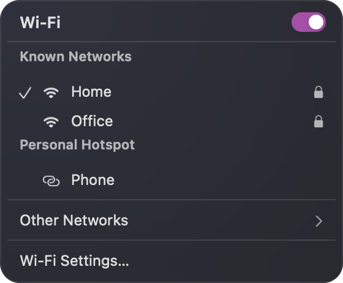
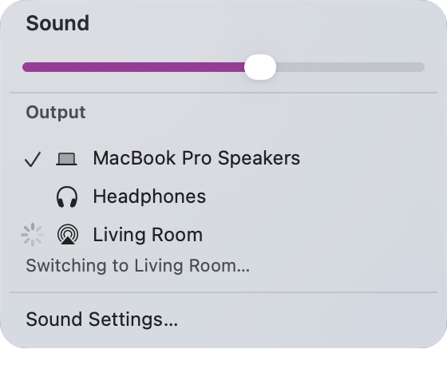
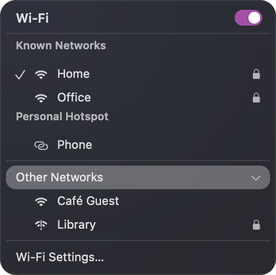
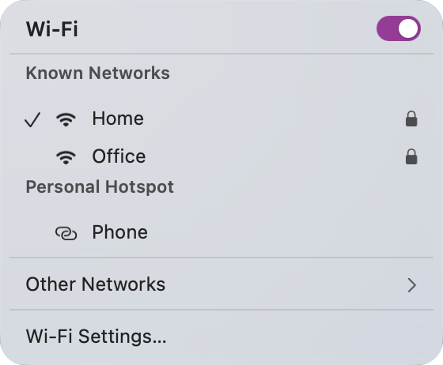
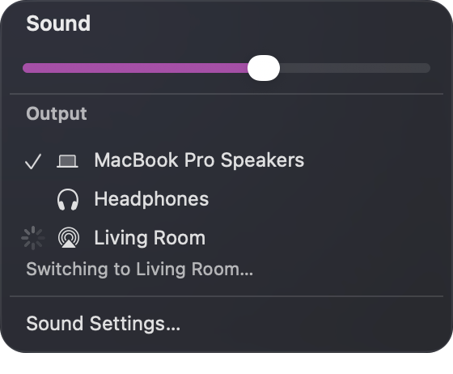

# BarPanels

**Drop-down panels for your status bar items, in Liquid Glass, that animate,
take the keyboard, and stay out of your screen shares.**

A small Swift library for macOS apps that put items in a status bar such as
[SketchyBar](https://github.com/FelixKratz/SketchyBar) and want a menu-like
panel under them, one that does more than a menu can: switches, sliders,
spinners, rows that slide into place as their content changes.

<p>
  
  &nbsp;
  
</p>

## What you get

- **Panels that feel like menus.** One opens under its bar item when your app
  is told to, and closes on a click anywhere else, including on another bar
  item.
- **Every change animates.** Rows are matched across rebuilds by what they
  say: kept rows slide to their new place, new ones fade in, gone ones fade
  out, and the panel's height follows a gentle spring. Clicks still land while
  it moves.
- **Built-in keyboard support.** Arrows, Return and Escape work in every
  panel, with no extra code.
- **Glass that stays readable.** Liquid Glass, tuned so whatever is behind the
  panel turns to soft shapes under a tint, in Light and Dark Mode alike.
- **Private by default.** Panels are left out of screenshots, recordings and
  screen shares.

## A panel in a few lines

Subclass `BarPanel`, build your rows in `buildContent()`, and hand them to
`show()`. Call `buildContent()` again whenever your state changes: the panel
animates from what it showed to what it shows now.

```swift
import AppKit
import BarPanels

final class WiFiPanel: BarPanel {
  var on = true

  init() { super.init(toggle: Notification.Name("com.example.wifi.toggle")) }

  override func buildContent() {
    let power = HoverRow("Wi-Fi", toggle: ("wifi", on), title: true)
    power.onClick = { [weak self] in
      self?.on.toggle()
      self?.buildContent()
    }
    let settings = HoverRow("Wi-Fi Settings…")
    settings.onClick = { BarPanel.openSettings("com.apple.wifi-settings-extension") }
    // The last two items (a separator and the settings row) are the footer.
    show([power, separatorBox(), settings], footer: 2)
  }
}
```

To open it, post its notification with the bar item's x position. A bar item's
click script usually does this through your app's command line:

```swift
DistributedNotificationCenter.default().postNotificationName(
  Notification.Name("com.example.wifi.toggle"), object: "1840", deliverImmediately: true)
```

## Rows

`HoverRow` is a menu-like row, highlighted under the pointer and acting on the
press.

| You want                      | Use                                                       |
| ----------------------------- | --------------------------------------------------------- |
| One of several choices        | `mark: .check(isChosen)`                                  |
| An on/off setting             | `toggle: (key: "…", on: isOn)`                            |
| The panel's own switch        | `toggle: …, title: true`                                  |
| A row that shows more rows    | `expanded: isOpen` (draws its chevron)                    |
| Work in progress              | `mark: .busy` (a spinner)                                 |
| An icon, a value on the right | `icon: NSImage`, `detail: "8 s"` (`setDetail` updates it) |
| A disabled row                | `enabled: false`                                          |

Checkmarks are for picking one of several things. A setting that is just on
or off gets a switch, which slides when the setting changes, even when the row
was rebuilt meanwhile.

Between rows go `separatorBox()`, `BarPanel.title(_:)` and
`BarPanel.sectionTitle(_:)` headings, `note(_:)` for wrapping secondary text,
and `accentSlider(…)` for a slider in the system accent color. Pass titles,
notes and sliders as `inset:` to `show()` so they line up with the text inside
the rows.

## Keyboard

A panel takes the keyboard while it's open, without bringing its app to the
front:

| Key            |                                                   |
| -------------- | ------------------------------------------------- |
| ↑ ↓, Tab, ⇧Tab | move between rows and controls                    |
| Return, Space  | act on the focused row                            |
| → ←            | open or close a disclosure row, or nudge a slider |
| Escape, ⌘W     | close the panel                                   |

A focused row shows its highlight, and a focused control gets a ring. Moving
the pointer hands the panel back to it. Override `handleKey(_:)` to add keys of
your own, calling `super` for the rest.



## The look

|                                    Dark Mode                                     |                                     Light Mode                                     |
| :------------------------------------------------------------------------------: | :--------------------------------------------------------------------------------: |
|   |   |
|  |  |

Stock Liquid Glass is either nearly clear or heavily frosted, depending on
whether its window has the keyboard, and resets itself on every resize.
BarPanels keeps it at one setting throughout: a light blur, a little extra
color, a gray tint behind the rows, and a shadow that sets the panel apart
from a page of its own shade.

## Add it to your app

BarPanels builds with Nix into a static library and a Swift module:

```nix
# flake.nix
inputs.bar-panels.url = "github:xav-ie/bar-panels";

# then, with the overlay applied:
nixpkgs.overlays = [ inputs.bar-panels.overlays.default ];
# or directly:
bar-panels = pkgs.callPackage "${inputs.bar-panels}/default.nix" { };
```

```sh
swiftc -I ${bar-panels}/lib -L ${bar-panels}/lib -lBarPanels Sources/*.swift
```

Build it with the same nixpkgs (and so the same Swift) as the app that links
it; the flake has no inputs of its own for that reason.

### Status bar integration

- **Clicks a status bar swallows.** A bar that keeps clicks on its items from
  reaching other apps (to stop them revealing the native menu bar) can post
  `BAR_CLICKED` instead, and open panels close as if clicked away from.
- **Screenshots of your own panels.** `SCREENSHARE_UI_CAPTURABLE=1` lets
  screen capture see them, and `SCREENSHARE_UI_DEMO=1` is a flag your panels
  can read to show fixed sample data.
- **Helpers.** `HelperProcess` runs a bundled helper that reports state as one
  JSON line per change and takes commands on stdin.

## Development

The main flake stays input-free; the development tools live in `dev/`:

```sh
nix flake check ./dev        # build the library and the previews, check formatting
nix run ./dev#previews       # redraw assets/*.png (flashes each panel on screen)
nix develop ./dev -c treefmt # format Nix, Markdown, YAML and Swift
```

The pictures in this README are drawn by the library itself
([`Previews/main.swift`](Previews/main.swift)), so rerun `previews` after any
change to how panels look.

## Status

Not published yet: it's used by
[screenshare-ui](https://github.com/xav-ie/screenshare-ui) and
[Virtual Headset](https://github.com/xav-ie/virtual-headset) while its API
settles.

## License

[MIT](LICENSE.md)
